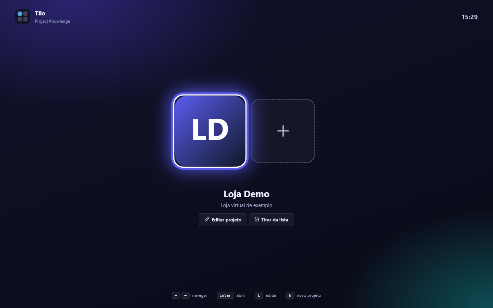
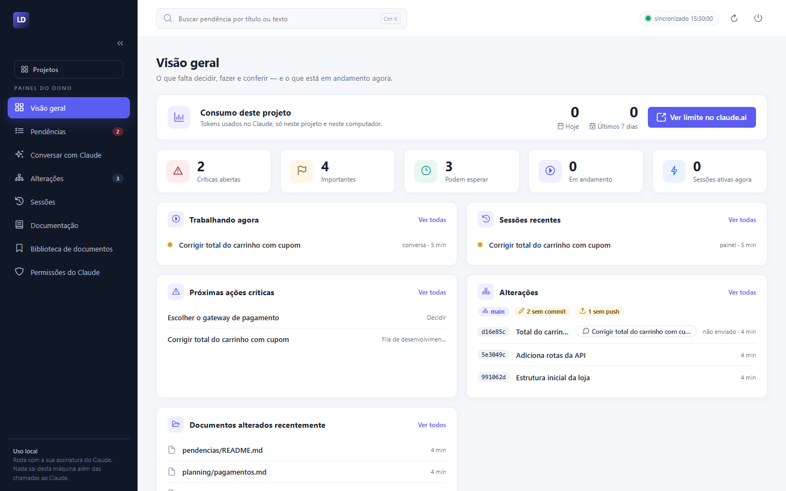
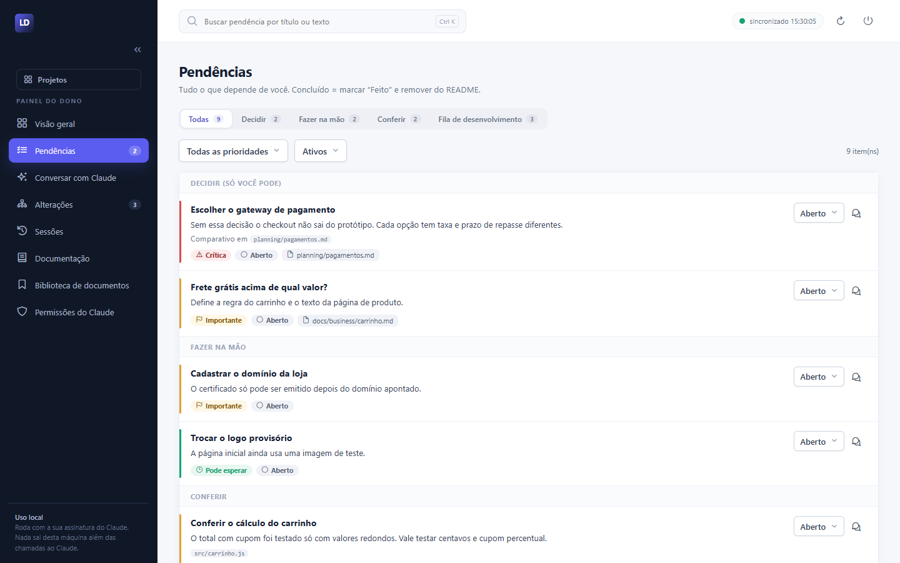
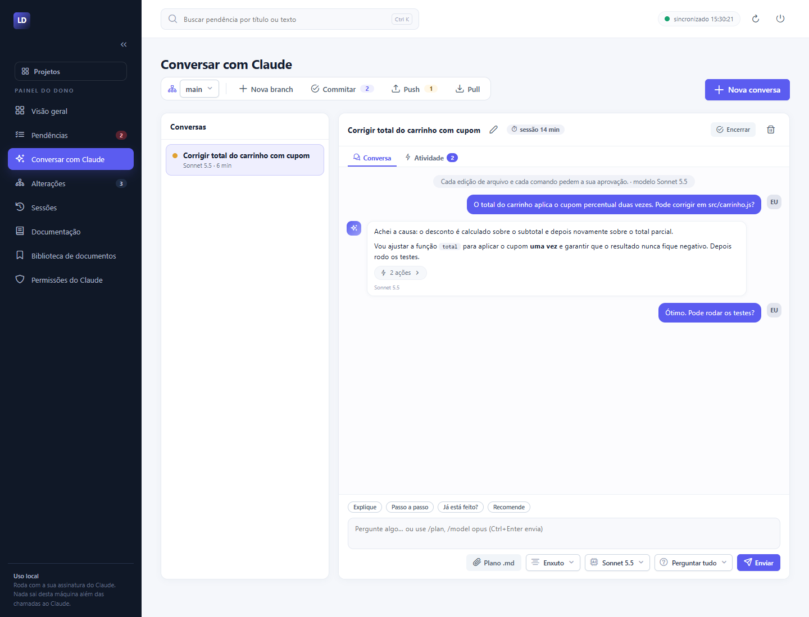
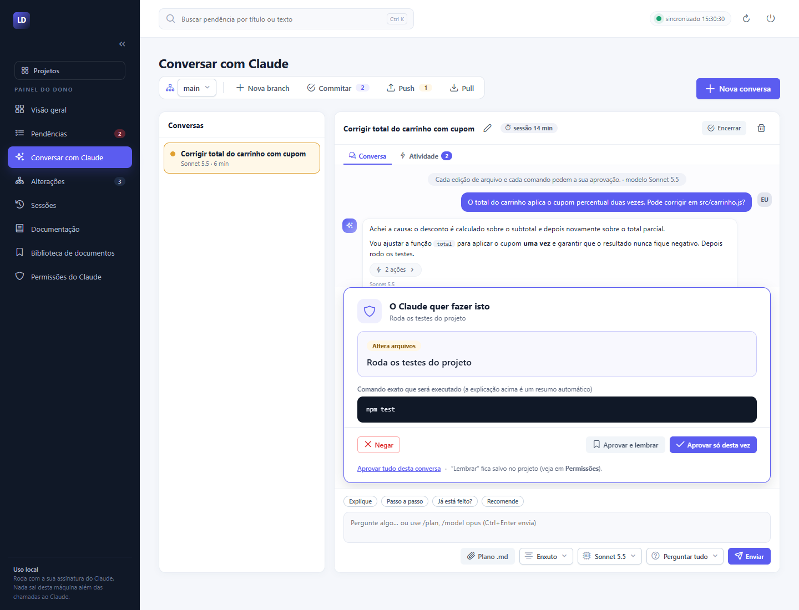
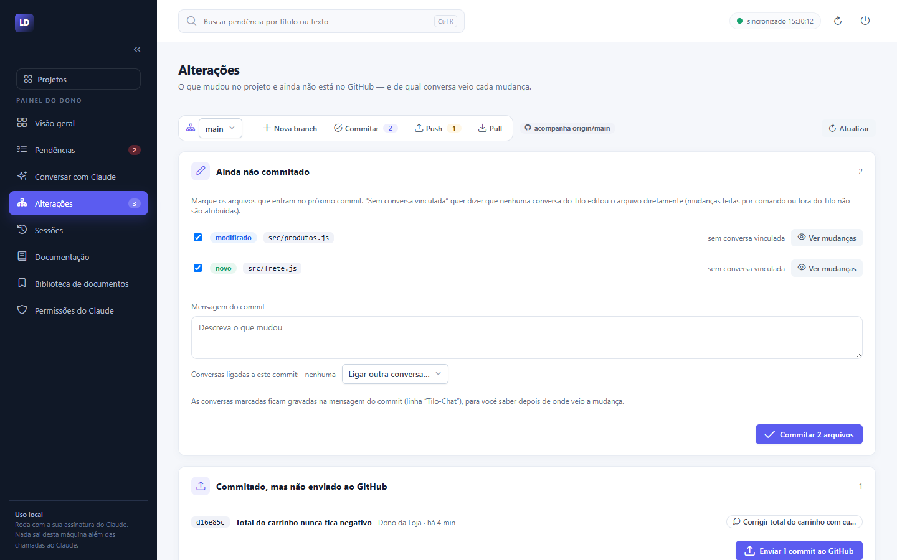
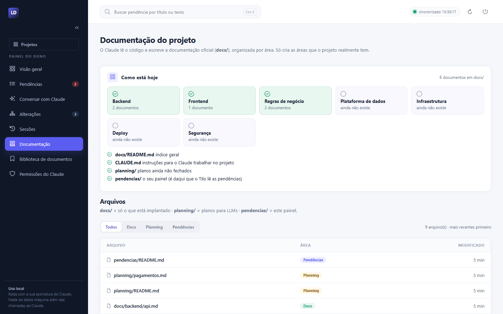
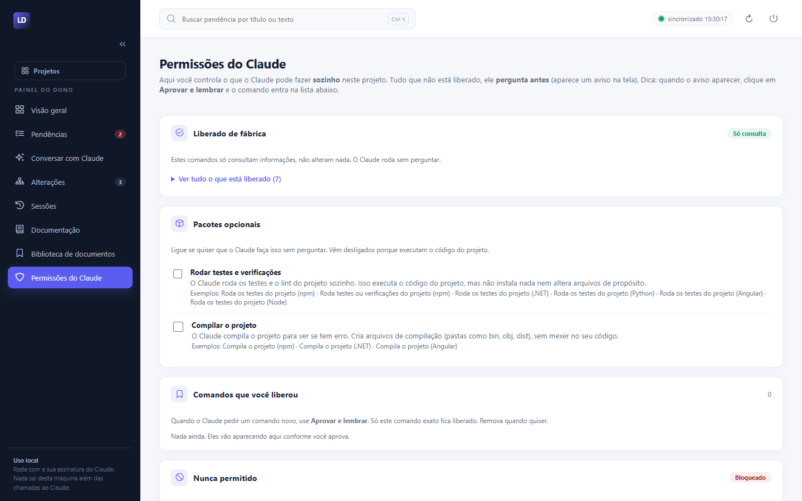

# Tilo — Project Knowledge

[](https://github.com/fabiobragato/tilo/actions/workflows/ci.yml)


[](LICENSE)


**Um painel local para quem trabalha com projetos de software e usa o Claude Code.** Você escolhe um projeto e, num só lugar, vê o que falta decidir e fazer, conversa com o Claude sobre o código, acompanha o que ele alterou e **aprova na tela, em português, cada comando que ele quer executar**.

Roda só no seu computador (`127.0.0.1`), usa a **sua assinatura** do Claude Code (nunca uma API paga) e não tem dependências: só Node.js.



## Sumário
- [Para que serve](#para-que-serve)
- [O que ele facilita](#o-que-ele-facilita)
- [Funcionalidades](#funcionalidades)
- [Como o Tilo se comunica](#como-o-tilo-se-comunica)
- [Segurança](#segurança)
- [Instalação](#instalação)
- [Usando o Tilo](#usando-o-tilo)
- [Estrutura do repositório](#estrutura-do-repositório)
- [Testes](#testes)
- [Documentação](#documentação)
- [Avisos](#avisos)
- [Licença](#licença)

## Para que serve

Trabalhar com o Claude Code no terminal funciona bem, mas, com vários projetos, algumas coisas se perdem: o que ainda precisa de uma decisão sua, o que cada conversa mudou, quanto você gastou, e o que exatamente o Claude está pedindo para rodar naquele prompt de permissão em inglês.

O Tilo junta isso por projeto, num painel simples:

- **Pendências do dono** (decisões, tarefas manuais, conferências e fila de desenvolvimento) lidas de um arquivo `pendencias/README.md` do próprio projeto.
- **Conversas com o Claude** no navegador, com fila de mensagens, modos de permissão e modelo à escolha.
- **Aprovação de comandos** com explicação em português e uma política que bloqueia o que é perigoso.
- **Visão do git** que liga cada mudança à conversa que a fez.
- **Documentação** do projeto escrita e conferida pelo Claude, e uma **biblioteca** para reaproveitar documentos técnicos entre projetos.

É pensado para o **dono do projeto**, inclusive quem não programa o dia todo: a linguagem das telas é simples e explicativa.

## O que ele facilita

| Sem o Tilo | Com o Tilo |
|---|---|
| Pendências espalhadas em notas e chats | Um painel por projeto, com prioridade 🔴🟡🟢 e estado de cada item |
| Prompt de permissão técnico, em inglês | Modal em português: o que o comando faz, se só consulta, altera arquivos, usa a internet ou mexe em servidor |
| Difícil saber qual conversa mudou qual arquivo | Aba **Alterações** com o vínculo arquivo → conversa e commit → conversa |
| Claude livre para rodar qualquer coisa ou pedir tudo | Política em camadas: bloqueia o destrutivo, libera só leitura, pergunta o resto |
| Documentação desatualizada | O Claude monta e confere `docs/` contra o código, valor por valor |
| Cada projeto novo começa do zero | Biblioteca de documentos generalizados, reaproveitável |
| Não saber quanto foi consumido | Tokens por conversa e estimativa de hoje e dos últimos 7 dias |

## Funcionalidades

### Seleção de projetos
Tela estilo console: `←` `→` navegam, `Enter` abre, `1`–`9` abrem direto, `E` edita e `N` cadastra. Cada projeto tem nome, pasta, cor, ícone e logo. Ao cadastrar, o Tilo pode criar a **estrutura base** (`pendencias/`, `docs/`, `planning/`, `CLAUDE.md`), sem nunca sobrescrever nada.

### Visão geral
Críticas abertas, importantes, o que está em andamento, sessões ativas, as próximas ações críticas, as últimas alterações do git e o consumo de tokens do projeto.



### Pendências
O painel lê `pendencias/README.md` do projeto (tabelas com 🔴🟡🟢). Filtre por seção, prioridade e estado, e abra uma conversa com o Claude já com o contexto da pendência. Regras em [`docs/business/pendencias.md`](docs/business/pendencias.md).



### Conversar com o Claude
Conversas no navegador, sobre o projeto, usando o Claude Code que você já instalou:

- **Fila de mensagens:** escreva enquanto o Claude trabalha; ele lê no próximo passo, como no terminal. **Parar** interrompe sem perder a conversa.
- **Modos** (um menu só): Perguntar tudo, Aceitar edições, Planejamento, Automático e Somente leitura. A troca vale na hora.
- **Modelo e tom** por conversa. O tom (Normal, Enxuto, Curto, Mínimo) reduz o tamanho das respostas.
- **Aba Atividade:** comandos e ferramentas ficam fora da conversa, numa lista ao vivo com status e duração. Só o comando é guardado, nunca a saída (que pode ter segredos).
- Perguntas com opções, modo plano com aprovação do plano, encerrar/reabrir, renomear e vínculo com uma pendência.



### Aprovação de comandos em português
Cada comando que o Claude quer rodar abre um cartão que explica o que ele faz e mostra o **comando exato** logo abaixo. Você escolhe: **Negar**, **Aprovar só desta vez**, **Aprovar e lembrar** (só aquele comando, neste projeto) ou **Aprovar tudo desta conversa**. Sem resposta em 5 minutos, o pedido é negado. Comandos de produção pedem uma confirmação extra.



### Alterações (git visual)
Branch atual e troca de branch, arquivos não commitados, commits ainda não enviados ao GitHub e histórico paginado. Cada mudança mostra **de qual conversa veio** (o commit leva uma linha `Tilo-Chat:` na mensagem). Dá para commitar arquivos escolhidos e enviar ao GitHub sem forçar. Arquivos que parecem segredos (`.env`, `.pem`, `.token`…) nunca são commitados nem têm o diff exibido. Veja [`docs/business/alteracoes.md`](docs/business/alteracoes.md).



### Sessões
Lista as conversas do painel e as **sessões do Claude Code que você rodou no terminal** (últimos 7 dias). Dá para ver o histórico, dar apelido, vincular a uma pendência, ocultar, continuar numa conversa do painel ou copiar o `claude --resume <id>`. O Tilo só lê esses arquivos; nunca os altera.

### Documentação com o Claude
O Claude lê o código e monta (ou confere) a pasta `docs/` num padrão por área: `backend/`, `frontend/`, `business/`, `security/` e as demais que o projeto realmente tem, além de `planning/`, `pendencias/README.md` e `CLAUDE.md`. O modo **Conferir** monta um inventário de fatos do código e compara com cada documento, corrigindo só o que diverge. Nessa conversa o Claude **não tem terminal** e só escreve nas pastas de documentação. As instruções que ele segue estão em [`modelos/documentar.md`](modelos/documentar.md) e podem ser editadas.



### Biblioteca de documentos
Acervo **local** de documentos técnicos dos seus projetos, por área. Você pode **publicar** documentos de um projeto (o Claude os *generaliza*, tirando o que é do seu produto, e você aprova o rascunho) e **anexar** documentos a outro projeto (copiando, ou adaptando ao projeto com o Claude). Regras de negócio, planejamento e pendências nunca entram. Detalhes em [`docs/business/biblioteca-de-documentos.md`](docs/business/biblioteca-de-documentos.md).

### Permissões do Claude
Tela para ver e ajustar o que o Claude faz sozinho em cada projeto: o que vem liberado de fábrica (só consulta), pacotes opcionais (rodar testes, compilar), comandos que você mandou lembrar, o que é sempre bloqueado e o que sempre pede atenção redobrada. Há um campo **Testar um comando** que apenas simula a decisão.



### Consumo de tokens
Selo com o total por conversa e, na Visão geral, o consumo estimado de **hoje** e dos **últimos 7 dias**, calculado dos arquivos que o próprio Claude Code grava. É uma estimativa local; o limite real da assinatura só existe em claude.ai > Configurações > Uso.

## Como o Tilo se comunica

```
 Navegador (index.html, inicio.html)
      │  HTTP + JSON, cookie de token         só em 127.0.0.1
      ▼
 server.mjs ──────────────┬─────────────► Arquivos locais
 (Node, sem dependências) │                 projetos.json, dados/<id>/, catalogo/
      │                   │                 <projeto>/pendencias/README.md, docs/
      │ spawn             │
      ▼                   │ lê (só leitura)
 claude (Claude Code CLI) └─────────────► Transcripts do Claude Code (~/.claude/projects)
      │  stdin/stdout em stream-json
      │  --permission-prompt-tool
      ▼
 aprovador-mcp.mjs (MCP via stdio)
      │  POST /api/p/<id>/aprovacao/pedir
      ▼
 politica.mjs: bloqueia · libera · pergunta  ──►  cartão de aprovação na tela
```

- **Navegador ⇄ servidor:** páginas em JavaScript puro conversam com a API do `server.mjs`. Rotas principais: `/` (seleção), `/p/<id>` (painel), `/api/p/<id>/...` (API do projeto), `/api/projetos` e `/logo/<id>`. A tela atualiza sozinha a cada poucos segundos.
- **Servidor ⇄ Claude Code:** uma conversa mantém **um único processo `claude`** enquanto houver trabalho, falando `stream-json` nos dois sentidos. Assim as mensagens novas entram na fila nativa do Claude Code. Nenhum texto seu vai em argumento de linha de comando.
- **Claude ⇄ aprovação:** a cada edição ou comando, o Claude chama o `aprovador-mcp.mjs`, que repassa o pedido ao servidor. A política decide; se for o caso, o cartão aparece na tela e a resposta volta ao Claude.
- **Dados:** cada projeto guarda estado, conversas, metadados de sessões e auditoria em `dados/<id>/`, **fora** da pasta do projeto. O `claude` roda com `cwd` na raiz do projeto, então usa o `CLAUDE.md` e o `docs/` dele.
- **Padrão de projeto esperado:** `docs/` (fonte de verdade), `planning/` (planos ainda não fechados), `pendencias/README.md` (painel do dono) e `CLAUDE.md` (instruções ao Claude).

Mais em [`docs/backend/architecture.md`](docs/backend/architecture.md) e [`docs/backend/ai-architecture.md`](docs/backend/ai-architecture.md).

## Segurança

- **Só local:** o servidor escuta em `127.0.0.1`, exige um token (arquivo `.token`, cookie `HttpOnly` + `SameSite=Strict`) e confere os cabeçalhos Host e Origin.
- **Só assinatura:** `ANTHROPIC_API_KEY` e `ANTHROPIC_AUTH_TOKEN` são zeradas nos processos que o Tilo cria.
- **Política de comandos** (`politica.mjs`), em ordem de decisão: *bloqueado* > *produção* > *comando lembrado* > *liberado de fábrica* > *pergunta*.
  - **Bloqueia:** apagar em massa, `docker compose down -v`, push forçado, `git reset --hard`, mexer em segredos (`.env`, `.ssh`, `.token`, chaves), enviar arquivos para a internet, executar código escondido (`| bash`, `iex`, base64) e falar com o próprio Tilo.
  - **Libera:** só leitura estrita (`git status`, `git log`, `git diff`, `ls`, `docker ps`…).
  - **Pergunta** o resto, com confirmação extra para produção (`ssh`, deploy, migrações, `git push`, rede externa).
  - Regras de fábrica não podem ser removidas, e "lembrar" nunca vale para produção nem para comandos bloqueados.
- **Proteção do próprio Tilo:** o Claude não pode editar o código do servidor, da política nem os arquivos de configuração do Tilo.
- **Auditoria:** cada pedido, risco, decisão e quem decidiu fica em `dados/<id>/auditoria.jsonl`.
- **Sem segredos no repositório:** dados, conversas, token, logos e a lista de projetos ficam em arquivos ignorados pelo git.

Detalhes em [`docs/security/`](docs/security/README.md) e [`docs/backend/command-policy.md`](docs/backend/command-policy.md).

## Instalação

**Pré-requisitos (Windows):** [Node.js](https://nodejs.org) 20+, [Git for Windows](https://git-scm.com/download/win) (Git Bash) e o [Claude Code](https://claude.com/claude-code) instalado e com login feito.

1. Clone o repositório e abra um terminal na pasta:
   ```
   git clone https://github.com/fabiobragato/tilo.git
   cd tilo
   ```
2. Confira o ambiente (diz exatamente o que falta; acrescente `-TestarLogin` para provar que o login do Claude funciona):
   ```
   npm run verificar
   ```
3. Crie o atalho na área de trabalho:
   ```
   powershell -ExecutionPolicy Bypass -File scripts\instalar-atalho.ps1
   ```
   Ou use `iniciar.cmd` (ou `npm start`). Na primeira vez, entre pelo link com token que o servidor imprime (`Primeiro acesso: http://localhost:4777/?t=...`); depois basta `http://localhost:4777/`.
4. Abra o Tilo e clique no tile **+** (ou tecle `N`) para cadastrar seu primeiro projeto: nome, pasta (caminho completo de uma pasta que já existe), cor e, se quiser, **Criar estrutura base**.
   - **Projeto que já tem código?** Marque **Montar a documentação do projeto com o Claude**: o Tilo abre a tela Documentação para você confirmar o início.
5. Abra o projeto. Escreva suas pendências em `pendencias/README.md` do projeto e **não apague esse arquivo**: é a fonte de dados do painel.

**Problemas comuns:** `No suitable shell found` significa que o Claude Code não achou o Git Bash. Defina `CLAUDE_CODE_GIT_BASH_PATH` (o `verificar` mostra o caminho) em `~\.claude\settings.json`, na chave `env`, e reinicie. O `bash` do WSL em `System32` não serve.

**Configuração opcional** (variáveis de ambiente, todas com padrão): `TILO_PORT` (porta, padrão 4777), `TILO_BIND`, `TILO_PUBLIC_PORT`, `TILO_CAVEMAN` e `TILO_CAVEMAN_NIVEL` (tom das respostas). Lista completa em [`docs/backend/configuration.md`](docs/backend/configuration.md).

> Os scripts de atalho e verificação são PowerShell (Windows). O servidor em si é Node puro e usa `spawn('claude', { shell: true })`.

## Usando o Tilo

- **Abrir:** o atalho *Tilo* (sobe o servidor oculto, se preciso, e abre o navegador já autenticado) ou `iniciar.cmd`.
- **Dentro do projeto:** o botão **Projetos** no menu lateral volta à seleção.
- **Parar:** encerre o processo `node server.mjs` (Gerenciador de Tarefas) ou use o botão de reiniciar do painel.
- **Logo:** no cadastro, escolha o ícone (quadrado) e o logo largo (menu lateral). PNG, JPG ou WEBP até 1,5 MB; SVG não é aceito.

## Estrutura do repositório

```
server.mjs            servidor HTTP, rotas, conversas, sessões, aprovações
politica.mjs          política de comandos (bloqueia, libera, pergunta, explica)
aprovador-mcp.mjs     servidor MCP usado como --permission-prompt-tool
projetos.mjs          cadastro de projetos, estrutura base e permissões
catalogo.mjs          biblioteca de documentos
fluxo.mjs, git.mjs, consumo.mjs, tom.mjs   fila de mensagens, git visual, tokens, tom das respostas
index.html, inicio.html, assets/           interface (JavaScript puro, sem build)
modelos/              instruções (prompts) de documentar, adaptar e generalizar
scripts/, iniciar.cmd verificação do ambiente, atalho e inicialização
docs/                 documentação oficial (fonte de verdade)
planning/, pendencias/ planos em aberto e painel do dono
*.test.mjs            testes (node:test)
```

Projetos cadastrados, dados, conversas, token e a biblioteca ficam em `projetos.json`, `dados/`, `logos/`, `catalogo/` e `.token`, todos fora do git. Há um modelo em [`projetos.example.json`](projetos.example.json).

## Testes

```
npm test            # política, biblioteca, projetos, consumo, fluxo, git e padrões de interface
npm run verificar   # confere o ambiente (Node, Git Bash, Claude Code, porta)
```

Não há lint nem build. A integração contínua (`.github/workflows/ci.yml`) roda os testes em Windows e Linux, com Node 20 e 22.

## Documentação

Tudo o que o Tilo faz está descrito em [`docs/`](docs/README.md), a fonte de verdade do projeto:

- [`docs/business/`](docs/business/README.md): regras e fluxos do produto.
- [`docs/backend/`](docs/backend/README.md): servidor, API, política de comandos, integração com o Claude.
- [`docs/frontend/`](docs/frontend/README.md): páginas, estado, design system (todo seletor usa o menu padrão de `assets/combo.js`).
- [`docs/security/`](docs/security/README.md): token, segredos e aprovação de comandos.

Para contribuir, leia o [`CLAUDE.md`](CLAUDE.md) (regras do projeto) e confira se `docs/` continua batendo com o código.

## Avisos

- **Uso local e responsabilidade.** O Tilo roda no seu computador e deixa o Claude ler arquivos e, **só com a sua aprovação**, propor comandos. A política reduz o risco, mas não o elimina: leia cada aprovação antes de clicar. Você é responsável pelo que aprova.
- **Sem afiliação.** O Tilo é um projeto independente e **não é afiliado, patrocinado nem endossado pela Anthropic**. "Claude" e "Claude Code" são marcas de seus respectivos titulares. O Tilo usa o Claude Code **que você instalou e no qual fez login** (a assinatura é sua); confira os termos de uso do Claude para o seu tipo de uso.
- **Seus dados ficam com você.** Pendências, conversas, auditoria, biblioteca e a lista de projetos ficam em arquivos locais ignorados pelo git.
- As imagens deste README usam um projeto fictício ("Loja Demo").

## Licença

O Tilo é **source-available**: o código é público, mas **não é open source** no sentido da [Open Source Definition da OSI](https://opensource.org/osd), porque o uso comercial é restrito.

| | Community | Business |
|---|---|---|
| Custo | Grátis | Pago (valores em definição) |
| Licença | [PolyForm Noncommercial 1.0.0](LICENSE) | Autorização comercial separada ([COMMERCIAL-LICENSE.md](COMMERCIAL-LICENSE.md)) |
| Para quem | Uso pessoal, estudo, pesquisa e organizações sem fins lucrativos, de ensino ou governamentais, nos termos da licença | Empresas e profissionais que usam o Tilo em atividade comercial, inclusive freelancers em projetos remunerados |
| Instalação | Local | Local (a diferença é o direito de uso, não o software) |

Dúvida se o seu uso é comercial? Veja [COMMERCIAL-LICENSE.md](COMMERCIAL-LICENSE.md) ou escreva para fabio_bragato@hotmail.com.

**Support Tilo development.** O patrocínio voluntário (GitHub Sponsors, ainda não ativado) ajuda a manter o projeto e **não concede licença comercial**.

O Tilo inclui os ícones do [PrimeIcons](https://github.com/primefaces/primeicons) (MIT; ver `assets/PRIMEICONS-LICENSE`). O tom das respostas (`tom.mjs`) é adaptado do plugin Caveman (MIT); o aviso está no cabeçalho do arquivo. Esses avisos continuam valendo para esses componentes. O nome "Tilo" e a identidade visual não são licenciados por este arquivo.

Para contribuir, veja [CONTRIBUTING.md](CONTRIBUTING.md); para segurança, [SECURITY.md](SECURITY.md).
